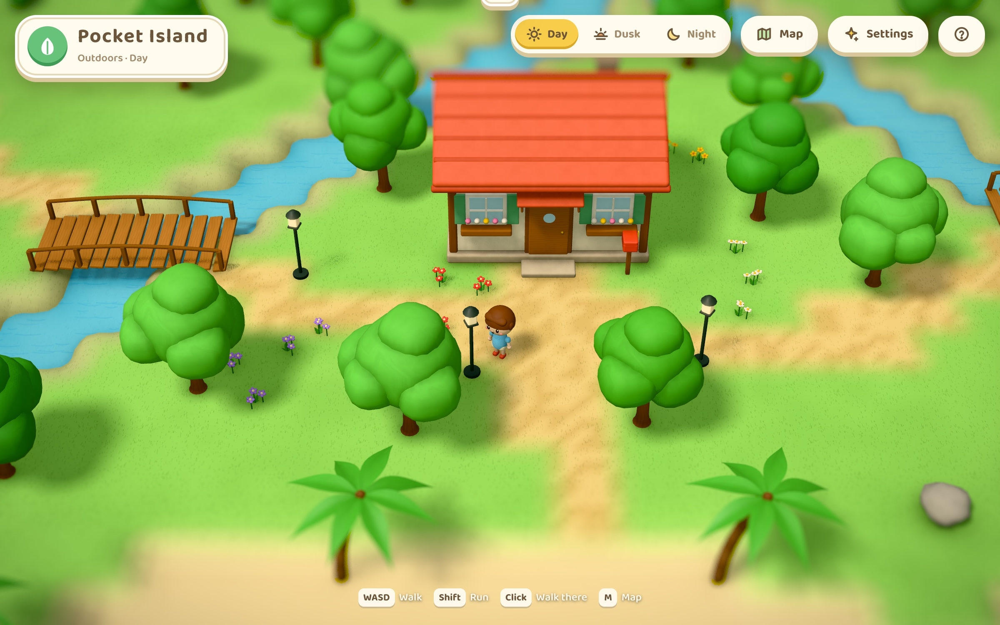
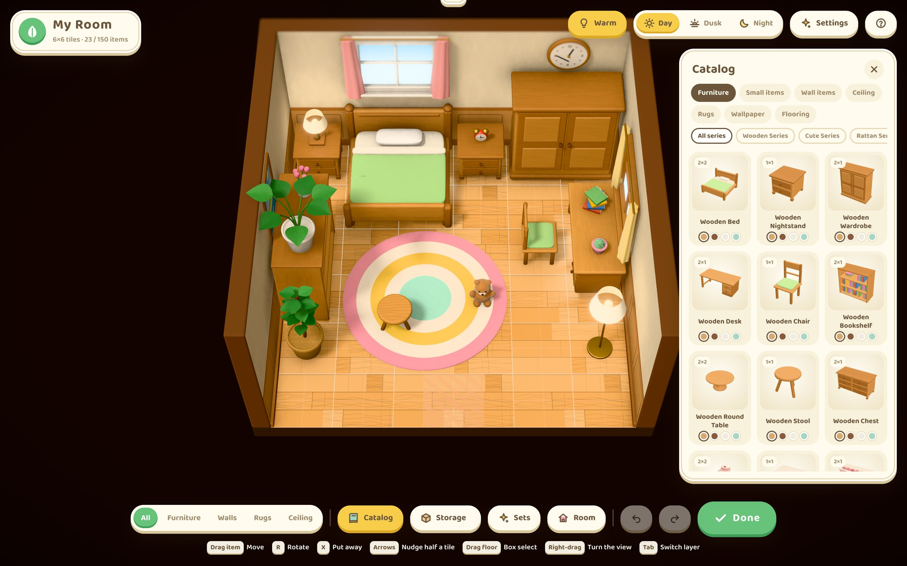
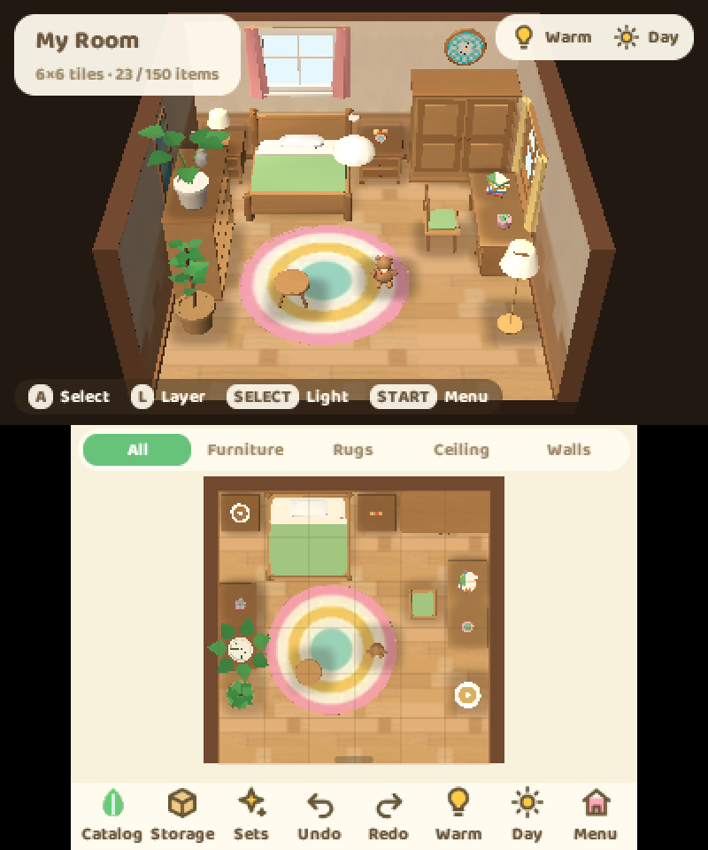

# Pocket Island

A small island in the style of the island life games, rendered in real time with three.js: a player walks its beaches, cliffs, river and paths to their house, and inside it decorates a cosy bedroom with a mode that follows the island's grid rules and a catalogue of furniture in matching series to pick from, recolour and swap. The same island and room run on a New Nintendo 3DS, with the world on the upper screen and the player's phone or the room's plan under the stylus on the touch screen ([Nintendo 3DS](#nintendo-3ds)).





The 3D room of [Pocket Studio](https://studio.pocket.nexus) was the reference. This project borrows its stage structure (one renderer, a frame loop and listeners), a camera rig that frames a rectangle that must stay visible, Khronos Neutral tone mapping, breathing lamp halos, pooled lamp lights, and its way of checking work with screenshots from headless Chrome over CDP. The difference is that the Pocket Studio room is baked in Blender Cycles and stays put, whereas here every piece of furniture can be moved, so all of the lighting is computed live.

## Running

```sh
rustup target add wasm32-unknown-unknown   # the core is Rust, built for the page as WebAssembly
bun install
bun run dev          # builds the core, then http://127.0.0.1:5317
```

| Command | What it does |
| --- | --- |
| `bun run check` | The core's Rust tests; the type check (the page, the tools and the console's interface, unused code refused); and the unit tests (the room's and the island's rules, walking and finding the way, what the hosts restate of the core held to it, catalogue, sets, showrooms, translations, sound, mods, the 3DS editor and player), all on the core |
| `bun run core` | Build the core as WebAssembly (`src/core/pocket_island_core.wasm`); `bun tools/core.ts --3ds` builds the console's archive |
| `bun run e2e` | End-to-end check: 57 checks of the decorating rules and flows, the furniture handled by hand, the light, the languages, the island, the pockets and the shop, driven with real mouse and keyboard events (needs `bun run dev`) |
| `bun run shot -- "<url>" --do "<steps>"` | Screenshot in headless Chrome; the steps are described at the top of `scripts/shot.ts` |
| `bun run build` | Bundle into `dist/` |

URL parameters:

- `?fresh` ignores the saved room and where the player was, and starts from the default room with the player at their door.
- `?place=island|house` starts outdoors or in the house.
- `?lang=en|zh|ja` picks the language.
- `?showroom=<series>` (`wooden` `cute` `rattan` `japanese` `starry` `nordic` `basic` `all`) opens that series' showroom. Add `&variant=1` to see each piece's second colour.

## Languages

The interface comes in English, Simplified Chinese and Japanese. It follows the browser's language on the first visit. You can change it under **Settings → Language**; the choice is remembered and the interface redraws on the spot. Each language has its own rounded typeface: Baloo 2 for English, ZCOOL KuaiLe for Chinese headings, and M PLUS Rounded 1c for Japanese.

All text lives in `src/i18n/`:

- `en.ts`, `zh.ts`, `ja.ts` hold the interface text under shared keys. TypeScript rejects a language file with a missing key.
- Catalogue names (items, colours, wallpapers and flooring, series, categories, sets, room sizes) are written in English where each thing is defined. `catalog.zh.ts` and `catalog.ja.ts` translate them by id; colours are keyed by their English name, since many pieces share them.
- `test/i18n.test.ts` fails if anything in the catalogue lacks a Chinese or Japanese name, if a translation drops a parameter, or if Chinese or Japanese text appears anywhere outside `src/i18n/`.

## The core

The rules and the player's game are one Rust crate, `crates/island-core`, `no_std` and taking no memory from a heap: everything it keeps is in fixed storage, so it runs the same on a page and on a handheld. It holds:

| Module | What it decides |
| --- | --- |
| `room.rs` | Whether a piece may stand where it is put (the grid, overlaps, rugs, table tops, walls, the ceiling, the doorway, the limit) and where a small thing lands on a table |
| `island.rs` | How high the island's ground is anywhere, whether a body fits (water, cliffs, inclines, bridges, trunks, the house), the door |
| `walk.rs` | Walking: the stick, acceleration, a run, sliding round what is in the way; finding the way to a click (A* on a half-tile grid, in fixed storage) |
| `indoors.rs` | Walking in the house: the furniture in the way, rugs underfoot, the doorway out; the room as last committed, piece by piece |
| `handle.rs` | The furniture by hand in the house: taking hold of a piece and pushing, pulling or turning it, picking it up into the pockets, putting one down from them |
| `pose.rs` | How the player stands: the swing of a walk, the lean of a run, a breath at rest |
| `game.rs` | The player's game: where they are, the door, the fade through it, a walk to a point, where the pockets may be stored or dropped, and the events a host hears |
| `things.rs` | The island's things: what lies about by the day, the trees, the fish, the pockets and the box, the tools' wear, and saves |
| `shop.rs` | The shop: its stock and prices, the day's kind that fetches more, the wallet and savings with their interest |
| `dex.rs` | The field guide: each fish's water and hours, what has been found, the largest of each |
| `ffi.rs` | Its C interface (`pi_*`), the same for both hosts |

The browser loads the crate as WebAssembly (`src/core/wasm.ts`); the console links it into the renderer (`bun tools/core.ts --3ds`, `programs/3ds-island/extension.mk`) and gives the interface's scripts the same functions as `globalThis.islandCore` (`programs/3ds-island/src/core_js.c`), while the renderer reads the player's place and pose from it each frame. `src/core/abi.ts` is that interface for scripts; `src/core/rules.ts`, `island.ts`, `walk.ts`, `things.ts` and `game.ts` hand the core the room and the island and ask it, keeping only the geometry the interfaces draw with, and `src/core/edits.ts` is what decorating does to a room, for both editors. The island's recipe stays in TypeScript, where the island is authored, and hands the core its map.

The unit tests run on the core: the room's rules, the island's (every bit of land reachable, the way to the highest cliff), walking and the console's player all go through the WebAssembly module, and `cargo test` checks the game's door, fade and paths, the things, the shop and old saves in Rust. `test/core-mirror.test.ts` holds what the hosts restate to the crate (items, outcomes, events, the game state's fields, the room's and the island's sizes, the constants in the console's header, the drawn heights against the walked ones) and fails when the console's bindings are not as `ffi.rs` writes them.

### Mods

Mods are scripts on top of the core, on the page and in the console's QuickJS alike (`src/mods/api.ts`). A mod reads the game, asks it to walk somewhere or go through the door, says messages from `src/i18n` the way the interface says things, keeps what it needs between runs, and hears `place`, `door`, `arrived` and `frame`. The mods a host starts are listed in `src/mods/index.ts`; `src/mods/welcome.ts` is one: it greets the player the first time they come home, and counts their visits.

## The island

The island outside the house is a map of tiles, one world unit each (`src/core/island.ts`), made by a recipe from one seed, the same on every run and on the console: a rounded coast with its wobble, a beach that is wide in the south and a strip in the rocky north, the island's floor, a second tier of cliffs across the north with a lobe at either end, and a third on two tops. A river rises in a spring on the high plateau, falls over both cliffs and splits before two mouths on the beach; there is a pond on the western cliff. Paths lead from the door; inclines are cut two tiles into the cliffs where they are wanted, and plank bridges cross the river. Trees gather in groves and leave clearings, cedars grow on the heights, palms and shells on the beach, flowers in patches and in beds by the house, with a mailbox and lamps along its path.

The rules say how high the ground is anywhere and whether a body fits there: the sea and the river are not walked into, a cliff is climbed only by an incline, and trunks, rocks, bushes, lamps and the house are in the way. Walking (`src/core/walk.ts`) turns toward the stick and accelerates to a walk or a run, slides round what is in the way, and finds its way on a half-tile grid when you click somewhere. The tests (`test/island.test.ts`) check that the recipe is stable, that no cliff climbs two tiers at once, that every bit of land can be walked to from the door, and that a walk from the door reaches the top of the highest cliff over a bridge and two inclines.

In the browser the ground is one height field over the island, four samples a tile, in chunks: each tier is a soft step whose edge follows the tiles, so cliffs rise steeply with a rounded lip and the beach slopes gently into the sea. Its colours are in its vertices (grass by tier in patches, rock in layers on the faces, sand, wet sand at the water, worn paths), with a faint texture of blades on flat ground. The sea is one plane coloured by the distance to dry land, from shallow over the sand to deep, with foam where the waves roll in; the river and pond are sheets at their level with falls where the river drops. The player is a small round-headed figure of jointed parts (`src/character/`) with a walk, a run and a breath. The camera follows them north over their shoulder, the sun casts their shadows and the trees', and after dark the lamps along the path and the house's windows light up. A click on the ground lays a trail of dots on it that march to a ring where the walk ends (`src/scene/route.ts`, the core's corners still ahead); the ring breathes and a wave spreads from it until the player gets there.

### The clock

The island keeps the device's own time (`src/core/clock.ts`). The day has three looks, day, dusk and night, each at its fullest at given hours (night until 4:48, dusk at 6:12 and 18:12, day from 7:48 to 16:36, night from 19:48); between two of them the light is a mix of both, eased, so the sky, the sun, the fog, the lamps and the windows change a minute at a time. In the browser the settings, and the phone's clock, have keys that move the clock back or forward three hours a second while they are held, and a key back to now; on the console so do the menu (the +Control Pad held on its row, too) and the phone's clock. Moving the clock past midnight is a new day for the island's things. The console's clock keeps local time and reports it as UTC, and its scripts' time zone is garbage (`getTimezoneOffset()` gave −17,921,911 minutes), so the clock reads hours and days through a time-zone offset of its own, which the console sets to 0.

### Gathering, digging and fishing

The island has things to gather (`crates/island-core/src/things.rs`), and the player carries them in twenty pockets (forty, bought from the shop ten at a time), with a storage box of sixty places in the house. They come with the date, the same for the same date on every run: each day shells wash in along the beach and yesterday's go, branches lie under the trees, weeds spread over the grass and stay until pulled, and four fossils are buried somewhere new under mounds of loose earth. A fruit tree carries three oranges, apples or peaches, which grow back two days after it is shaken; any tree gives three pieces of wood a day.

A press of A (Space in the browser) picks up or pulls what is at the player's feet or just ahead, and otherwise uses what is in their hand. With nothing, it shakes a tree, and its fruit or sometimes a branch falls. The axe chops a piece of wood off. The shovel digs up a fossil (an ammonite, a trilobite, a shark's tooth or a fern in stone). Fish swim about the water near the player as dark shadows, as many as six at once (five kinds in the sea, four in the river, two in the pond, each kind at its hours); a shadow's size is its kind's, from a minnow's to a catfish's. The rod casts into the water ahead, and a fish comes to the float only if it lands where that fish can see it: ahead of it, within about three tiles and sixty degrees either side of the way it heads. It stops, turns to the float and comes, nibbles, then bites, and only a press at the bite lands it; one before frightens it off, one too late and it is gone with the bait. A float that lands on a fish frightens it off, and so does running past (walking does not): the shadow darts away and is gone, and others come in time. While an action plays out the player stands still, posed for it; moving the stick brings a line in. The tools (shovel, axe, rod, and empty hands) come round with left and right on the +Control Pad (Tab, or 1 to 4, in the browser); down puts the tool away. Y picks up what is at the player's feet and nothing else. A tool wears with each use, a chop, a dig or a cast (a shovel lasts forty, an axe fifty, a rod forty), and breaks with its last.

The phone's Pockets app (X opens and closes it, in the browser too) shows what is carried, the coins in the wallet and each tool's wear: a tool to take in hand, anything to drop on the ground outdoors, and in the house a piece of furniture to put down (below) and the box beside the pockets, to put in and take out. On the console they follow the handheld island games (Animal Crossing: New Leaf's manual): X opens the pockets on the touch screen, where the player stands still and the +Control Pad or the Circle Pad moves the cursor; A, or a tap, on something brings up what can be done with it beside it (hold or put away a tool, drop, put in the box or take out), A does it and B closes the list, then the pockets. Outdoors A uses what is in hand and never picks up; Y picks up. What is carried and what lies about is kept between runs.

### The shop and savings

South-east of the house, by the path to the beach, is a market stall under a striped canopy, kept by Mori, a capybara with a citrus on their head (`crates/island-core/src/shop.rs`). A (Space) at the counter, facing Mori, opens the shop; a click on the stall in the browser walks up to it. Mori talks as everyone on the island does (`src/npc/talk.ts`): their lines come a few letters at a time in a speech box with their name on it, at the bottom of the screen (the console's upper screen), and a question's answers are chosen with the arrows (the +Control Pad) or a click (a tap). They say hello, ask before anything is bought and before anything is paid for, and say goodbye when the player leaves. The shop has three tabs:

- **Buy**: a shovel, an axe or a rod for 600 coins, and ten more pockets, for 3,000 and then 8,000. Mori names the price and asks.
- **Sell**: the pockets, with what each fetches today. What is clicked (A) is set out on the counter; Mori offers for all of it together, and pays on yes. Everything gathered sells, from a branch at 5 coins to a koi at 3,000; each day Mori pays half as much again for one kind of thing (shells, fruit, fish or fossils), and says which.
- **Savings**: coins between the wallet (999,999 at most) and savings (9,999,999), which earn 0.2 % each new day, for each day since the last (a month of days at most; a clock put back pays nothing).

On the console L and R change the tab; in Buy up and down choose and A buys, in Sell the +Control Pad chooses, A sets it out (or takes it back) and Y sells what is set out, in Savings left and right choose how much (100, 1,000, 10,000 or all), A deposits and Y withdraws; B leaves. The coins and the pockets are kept with the rest of what is carried.

### The field guide

The phone's Guide (`crates/island-core/src/dex.rs`) lists the eleven fish and the four fossils. A kind not found yet is its shape; one found shows where it is had and when, how many have been caught or dug up, the largest fish of its kind, what it fetches, and the day the first was found. The first of a kind is said ("New in your field guide!"). Each fish swims in one water at its hours: the sea's sardine, mackerel and flounder all day, the sea bream from 4:00 to 21:00 and the pufferfish at night; the river's minnow and carp all day, the trout from 16:00 to 9:00 and the catfish at night; the pond's goldfish by day and its koi from 16:00 to 9:00.

### Music and sound

The island's music and sounds are made by the game itself, from nothing (`src/audio/`): a few soft instruments (a marimba, an electric piano, a nylon string, a round bass, a music box, a pad, a breathy flute, brushed drums), noise and filters, and a small room's reverb. Four pieces of one family, written for the island, play by the hour, each a seamless loop of sixteen bars:

| Hours | Piece |
| --- | --- |
| 5:00–10:00 | F major, 88 a minute: a flute over a nylon string's arpeggios |
| 10:00–17:00 | C major, 104, swung: a marimba, the electric piano's offbeats, a walking bass |
| 17:00–20:00 | E♭ major, 80: the electric piano over a pad, brushes |
| 20:00–5:00 | D minor, 70: a music box, a pad and a held bass |

A new piece comes in over three seconds as the old one goes; inside the house the music is softer and darker, and it is lower while someone talks. Each step is heard on what is underfoot (grass, sand, the path, a bridge's planks, the doorstep's stone; inside, the floor as its flooring is, or a rug), four of each, a run louder and brisker. So is what the hands and the tools do (a swing and its chop or dig, a cast and the float's plop, picking up, pulling a weed, a tree shaken, something landing), the fish (a nibble, the bite, the catch's fanfare, one getting away), a tool breaking, a new kind in the field guide, the door, coins changing hands, the interface's keys, and the syllables the island's people speak in as their lines come. The settings switch music and sounds off (on the console, the menu).

The browser renders everything in a worker the first time it is wanted and plays it once a key or a click has let it. The console plays the same (`tools/sound.ts` writes it into `sound.pack`: the sounds as samples, the music as IMA ADPCM) through `programs/3ds-island/src/audio.c`: through the DSP when the console has the DSP's firmware (`/3ds/dspfirm.cdc`, the music streamed a block at a time), and otherwise through the sound hardware's own channels (CSND), which need none (each piece decoded whole by a thread of its own, then looped by the hardware).

### The phone

The player carries a phone (`src/ui/phone.ts`; on the console `apps/island-3ds/phone.tsx`, where it is the touch screen outdoors). Its status bar has the clock and the island's name; its home screen a clock and the apps: the island's **map** with where the player is, where a click walks there (from inside the house, out of the door first) with the same marching dots to a ring, the **pockets**, the field **guide**, **home** (to the door and in, or out of the house), the **settings** and **help**; the home screen's clock opens the **clock**, with the day's looks along a bar. Its round key goes back to the home screen, and from there puts the phone away.

| Input | Action |
| --- | --- |
| `WASD` / arrow keys | Walk; hold `Shift` to run |
| Click the ground | Walk there, round whatever is in the way |
| Click the house, walk into the door, or `E` at it | Go inside |
| Walk out through the doorway | Come back out, in front of the door |
| `P` / `M` | The phone / its map of the island |
| `Space` | Pick up, shake a tree, or use the tool in hand: chop, dig, cast, reel in; at the stall's counter, the shop |
| `Tab` / `1`–`4` | The next tool / empty hands, the shovel, the axe, the rod |
| `X` | The phone's pockets |
| `Space` held at a piece, in the house | Take hold of it: the keys then push it, pull it or turn it; a tap switches a lamp |
| `F`, in the house | Pick up what is ahead into the pockets |

Inside, the player walks between the furniture (rugs underfoot, the rest in the way) and a click on the floor walks there; decorating is as it always was, and when it is done the player steps aside from anything put where they stood.

### The furniture by hand

Outside the editor the player handles the room's furniture as on the island games (`crates/island-core/src/handle.rs`). A held at a piece standing on the floor (Space in the browser) takes hold of it, the player turned square to it; the stick toward the piece then pushes it half a tile, away from it pulls it (the player stepping back with it) and to either side turns it a quarter in place, as the room's rules let it: a move that would leave the grid's rules or give the player no room to stand is refused with a bump. Each move takes a quarter of a second, the player's step eased as the renderers ease the piece, and what stands on a table goes with it. A tap of A that moves nothing switches the lamp or television ahead, a lamp on a table before the table.

Y (F) picks up what is just ahead into the pockets: what stands on a table first (the nearest the hands), then the table; on the floor; on the wall the player faces; the rug underfoot. Ceiling pieces are put up and taken down in the editor. In the pockets a piece shows the catalogue's picture of its look and its name, and in the house **Place** puts it down in front of the player, facing them: on a table ahead when it is small enough to stand on one (beside what already stands there), on the wall faced when it hangs (facing away from a wall, it says so), under the player when it is a rug, a half tile aside or further off when the spot ahead is taken. A piece is carried by its number in `src/furniture/codes.ts` and its look, so pockets kept between runs keep it. Moves can be undone in the editor; what went into the pockets or came out of them starts the room's history again, since an undo would otherwise make a piece twice.

## Grid rules (as on the island)

The rules are the core's (`crates/island-core/src/room.rs`), snapping to the grid among them; `src/core/rules.ts` hands it the room. They don't depend on rendering, and `test/rules.test.ts` covers them.

- The floor is a grid of tiles (1 tile = 1 world unit). Things take up whole tiles and **can stop on half tiles** (they snap to 0.5).
- Each turn is 90° clockwise and swaps width and depth. When there's no room to turn, the turn is refused and you're told why.
- Furniture and small items can't overlap on the floor.
- **Rugs are a layer of their own.** Furniture can stand on them, but rugs can't overlap each other.
- **Small items can go on tables and cabinets.** Each piece defines the size and height of its top, and the top has its own grid. When the table moves, turns or goes into storage, whatever is on it goes too.
- **Walls have their own grid** (back, left and right walls, 3 tiles high). Wall items and windows can't overlap on the same wall, and never clash with floor furniture.
- **The ceiling is its own layer**, for pendant lamps and hanging things (added in the game's 2.0 update).
- The tile in front of the door must stay clear.
- A room holds at most **150 items**, counting the walls and ceiling.
- Room sizes: tent 4×4, cottage 6×6, main room 8×8, upstairs or basement 10×6. When the room shrinks, whatever no longer fits goes into storage.
- The ceiling light has three settings, warm, cool and off (the game's up button). Day, dusk and night change the view through the windows and how much daylight comes in.

## Catalogue

108 pieces of furniture with 383 colour variants, plus 12 wallpapers and 11 floorings. Every piece has a footprint and colour choices. Tables and cabinets have tops. Lamps switch on and off and really light the room, and televisions, computers and the handheld console have screens that switch on.

| Series | Pieces | What's in it |
| --- | --- | --- |
| Wooden | 10 | Bed, nightstand, wardrobe, desk, chair, bookshelf, round table, stool, chest, lamp (4 wood colours) |
| Cute | 14 | Princess bed, vanity, scalloped wardrobe, heart chair, sofa, round table, floor lamp, bunny plush, music box, heart mirror, bunting, pendant lamp, heart rug |
| Rattan | 13 | Rattan bed, armchair, hanging egg chair (1.5×1.5, a half-tile size), low table, cabinet, floor lamp, ceiling fan, bird of paradise, surfboard, shell wind chime, woven rug |
| Japanese | 12 | Futon, round low table (1.5×1.5), floor cushion, andon lamp, tansu chest, folding screen, bonsai, tea set, hanging scroll, round shoji window, paper lantern, tatami mat |
| Starry | 13 | Starry bed, moon chair, cloud sofa, desk, telescope, star lamp, globe, moon wall lamp, star string lights, planet mobile, round window, cloud rug |
| Simple | 15 | Bed, desk, sofa, lounge chair, side table, tripod floor lamp, cube shelf, floor mirror (1×0.5), snake plant, wall shelf, art print, globe pendant, wool rug |
| Odds & Ends | 31 | TV stand and flat-screen TV, retro TV, record player, laptop, desk fan, handheld console, aquarium, scented candle, mug, guitar, piano, plants, alarm clock, books, teddy bear, windows, wall clock, poster, air conditioner, pendant lamp, chandelier, rugs and more |

The **Sets** drawer has 7 whole rooms: Wooden Bedroom, Pink Princess Room, Rattan Getaway, Japanese Cottage, Starry Dream, Nordic Simple and an 8×8 Big Bedroom mixing every series. It also has a showroom for each series, which sets out every piece of the series in one big room by the same rules, to look at piece by piece. Opening a showroom doesn't overwrite your saved room.

New furniture is authored as described in `docs/furniture-authoring.md`.

## Controls

Outside decorating mode: drag to turn the view, use the wheel to zoom toward the pointer, click a lamp or a TV to switch it, and press `E` to start decorating.

While decorating:

| Input | Action |
| --- | --- |
| Drag an item | Pick it up and move it. The footprint shows green where it fits and red where it doesn't; let go to put it down |
| `R` | Rotate 90° clockwise |
| `X` / `Delete` | Put into storage |
| Arrow keys / `WASD` | Nudge the selection half a tile |
| Drag the floor / `⇧`+click | Box-select or add to the selection, then move several at once |
| `Tab` | Switch layer: all, furniture, walls, rugs, ceiling |
| Right-drag (`⇧` to pan), wheel | Move the view |
| `⌘Z` / `⇧⌘Z` | Undo / redo |
| `L` | Switch the ceiling light |
| `Esc` | Stop placing, or clear the selection |

The bottom toolbar has the layers and four drawers:

- **Catalog**: furniture, small items, wall items, ceiling, rugs, wallpaper and flooring, filtered by series, with a colour picker on each piece.
- **Storage**: whatever you've put away, ready to take out again.
- **Sets**: the whole rooms and the series showrooms.
- **Room**: size, put everything away, export and import the layout, reset to the default room.

When something is selected, the panel on the left changes its colour, rotates it, switches it on or off, or puts it away. The layout is saved in the browser as you go.

## Rendering

- **Lights**: a key light from high above the front left casts soft shadows back and to the right, where the camera can see them. A shadowless light from the camera's side lights the fronts of things. A sky-and-floor hemisphere and a soft room environment map fill in the rest.
- **Soft shadows** (`src/scene/shadows.ts`) use PCSS: a 16-tap blocker search and a 56-tap filter with a receiver-plane depth bias. Shadows are crisp where things touch the floor and soft where they're lifted.
- **Ambient occlusion** comes from N8AO. The picture then goes through Neutral tone mapping, a little extra saturation and contrast, and a vignette.
- **Bloom** is taken only from surfaces that give off light (lamp shades, bulbs, windows, screens), and grows stronger at night. A wall lit by a lamp never blooms.
- **Lamp lights** act as soft balls about half a tile across, and the light one lamp puts on any surface is capped. A lamp standing against a wall can't blow the wall out (`installLampFalloff` in `src/scene/lighting.ts`).
- **Tilt-shift** is a hand-written single-pass blur (`src/scene/tiltshift.ts`), softened while decorating.
- **Edges**: 4× MSAA. The selection outline is a back-face hull pushed out along the normals, and it turns red where an item can't go.
- **Lamp light pool**: lamps draw from a fixed pool of point lights, so switching a lamp never recompiles materials.
- **Sunbeams**: by day, sunlight through each window lays a patch of light with the window's panes on the floor. It turns amber at dusk and is gone at night.
- **Frame rate** at 3024×1964 (2× pixel density) on an M3 Max: the default room runs at 60 fps, and a showroom with about 100 pieces at about 53–56 fps.

## Nintendo 3DS



The island and the room run on a New Nintendo 3DS the way [Pocket3D](https://github.com/pocket-nexus/pocketjs/tree/main/pocket3d) builds a game: **everything is modelled once, as the three.js content above, and a compiler lowers it to what the console draws**. Outdoors the upper screen follows the player over the island and the touch screen is the player's phone, a cartoon handset across the screen whose map app walks the player wherever it is tapped, with dots marching to a ring on the map and on the ground; in the house the upper screen shows the room in 3D (in stereo with the 3D slider up) and the touch screen is the phone again while the player walks the room and handles its furniture; down on the +Control Pad decorates, and the touch screen holds the room's plan, the layers, the toolbar and every list, after the handheld decorating games: the stylus moves furniture on a plan of the room while the player walks the room on the upper screen.

| Part | What it is |
| --- | --- |
| `export.html`, `src/export/export.ts` | The export page. It runs the catalogue's own builders, materials and canvas textures in headless Chrome and hands over each item's and variant's meshes by material, the pictures they read, and the catalogue's pictures; and the island: its ground and water chunk by chunk with their colours in the vertices, the house, bridges, inclines, every prop's looks and where each stands, the player's parts, and the map's picture (`tools/export.ts` writes them to `.pocket-build/ir`) |
| `tools/cook.ts` | The compiler. It welds each part's seams, simplifies it until its surface would move more than 0.014 tiles, works its normals out again with a 50° crease, merges parts that draw alike into one draw with the material's colours in the vertices, orders them for the vertex cache, and encodes every texture as ETC1 with its mip chain (devkitPro's `tex3ds`). Painted surfaces (the island's ground and sea) are simplified with their colours as attributes, so a path's edge or the wet sand stays put. Everything on the island that stands still is drawn with the chunk it stands in: each prop, simplified to at most 420 triangles, joins the chunk's draws, so a chunk is a handful of draws. The light the console draws by (the room's for each ceiling mode and look of the day, the island's for each look) and the room's shell are the export's, from the browser's own (`src/scene/lighting.ts`, `shell.ts`); the one lowering of its own is the island's night, lifted for a screen without a tone curve. It writes `island.pack` (its layout is `programs/3ds-island/src/pack.h`), and the catalogue and the island's map the interface compiles from |
| `programs/3ds-island` | The renderer, linked into [PocketJS](https://github.com/pocket-nexus/pocketjs)'s 3DS product as its product extension, with the island's core (`crates/island-core`) linked into it and given to the interface as `globalThis.islandCore`. It draws the room with the browser's light for each ceiling mode and time of day, per vertex: a hemisphere, a key from above the front left, a front light, and the four strongest lamps that are on (a lamp's program runs only for what it reaches). Furniture throws a soft shadow, a lamp that is on shows a halo, the windows show the hour's sky. The touch screen's plan is the same room drawn from straight above, or one wall face on, into a canvas when it changes. Outdoors it follows the player with the browser's camera and the sky's light for the time of day, culls the island's chunks to the view, lights what stands still from the lamps after dark with their light worked out on the console the first time each piece is drawn and kept with it (worked out again whenever the island or its lamps change, so the island can be reshaped as it is played), lays soft round shadows under the trees and the player in one draw, draws the player as six parts turned about their joints by the pose it reads from the core, and lays the route of a tap on the ground: dots in one draw, a ring that breathes, a wave and its middle in three more |
| `apps/island-3ds` | The interface: a PocketJS app (Solid) for both screens. Its editor asks the core the room's rules and keeps its history; it hands the core the island, the room and the stick (`apps/island-3ds/outdoors.ts`), runs the mods, and speaks the languages of `src/i18n`. It hands the renderer the room through `globalThis.island` |
| `tools/fonts.ts` | Each language's glyphs in the browser's faces: Baloo 2; Noto Sans SC and ZCOOL KuaiLe for Chinese; M PLUS Rounded 1c for Japanese. The renderer loads a language's atlases when the interface changes language |
| `tools/n3ds.ts` | Build, install over the console's paired development connection, push the interface alone, capture both screens, run JavaScript on the console, read its frame timings, and drive it with scripted stylus and button input |

```sh
bun run setup                                   # the PocketJS submodule and its packages
bun tools/n3ds.ts build                         # → .pocket-build/3ds/dist/pocket-island.3dsx
bun tools/n3ds.ts install --host <console>      # build, send, start (pair once: vendor/pocketjs/tools/3ds-dev.ts pair)
bun tools/n3ds.ts capture --host <console>      # both screens as one picture
bun tools/n3ds.ts input "tap:20,222;wait:30" --host <console>   # open the catalogue
bun apps/island-3ds/test/preview.ts ja          # every sheet on the host, from the compiled bundle
```

The compiler takes the catalogue from **5,040,000 triangles to 159,000** (416 a variant on average, the cloud sofa's 2,073 the most), and the pack is **10.3 MB**: meshes 7.4 MB, 134 ETC1 textures 2.8 MB. Measured on a New Nintendo 3DS XL with the 3D slider down, the wooden bedroom (23 pieces) draws **5,870 triangles in 69 draws at 60 frames a second**, a frame's runtime tick (the interface, layout and both screens) taking 10.7 ms. The plan is drawn again only when the room, the layer or a held piece changes. Triangles are what the console pays for: about 0.42 ms a thousand with this light, which is why the compiler simplifies as far as a pixel at the room's framing allows.

The island's models come to **76,800 triangles** after simplification (the ground and water 22,900 in 30 chunks, the props 11,700 across their looks, the player 739), from 274,000. Outdoors at the door at night, the renderer culls the chunks and the 4 × 4-tile cells of props to the view and draws **26,600 triangles in 129 draws, a frame in 17.3 ms** (the runtime's tick 13.7 ms); `bun tools/n3ds.ts perf` measures six places by the house, the stall and a bridge by night and by day, and fails over its budget. The player's game runs in the core, linked into the program: a frame's step takes **0.03 ms**, and a tap on the map finds the way from the door to the top of the highest cliff in **17 ms** (a short walk in under 1 ms), on a grid of the island judged once when the game is restored (0.2 s). Before the core, the same rules in the interface's QuickJS took 1.8 ms a step and half a second for a short walk's search. With the phone out on the touch screen, a frame on the island holds **56–57 frames a second** in daylight: the interface's scripts take 1.6 ms of it, and the tick that runs them, lays out and draws both screens' interface and waits for the GPU about 15 ms. The phone costs about 1.5 ms of that, because its map is a picture the size it is shown (256 pixels, drawn a texel a pixel); its digits are plain bars; nothing on it is clipped; and the renderer's clear is the table it lies on. A first version cost 10 ms: a 512-pixel map shrunk to fit, thirty rounded bars, a rounded frame drawn row by row and a full-screen table. The lamps by the house once held the frame there to 30 a second, their light worked out by the shader for every vertex they reached; it is now kept with what stands still, and writes to the SD card (55 ms each) go to a thread of their own.

### On the console

| Input | Action |
| --- | --- |
| Tap a piece on the plan | Select it; tap it again to turn it |
| Drag a piece | Move it, with the rest of the selection. Its footprint shows green on the floor where it fits and red where it does not; the reason is said when it is let go |
| Drag onto Put away | Store it |
| Drag empty floor | Select what the box covers |
| L or R held + tap | A copy beside it |
| +Control Pad | Move the cursor, or the selection half a tile |
| A / X / Y / B | Select under the cursor / rotate / put away / cancel; B with nothing chosen ends decorating |
| L / R | Layer: all, furniture, rugs, ceiling, walls (each wall face on) |
| Circle Pad | Walk (B held, or outdoors L or R: run), on the island and in the house |
| A at the door | Go inside; walk out through the doorway to come back out |
| A outdoors | Use the tool in hand (chop, dig, cast, reel in), shake a tree, or talk; at the stall's counter, the shop |
| Y outdoors | Pick up or pull what is at your feet |
| A held at a piece, in the house | Take hold of it: the Circle Pad pushes, pulls or turns it; a tap switches a lamp |
| Y in the house | Pick up what is ahead into the pockets (a piece there is put down with Place) |
| +Control Pad down, in the house | Decorate: the plan, the layers and the toolbar on the touch screen |
| X | The pockets on the touch screen (while decorating, with nothing selected) |
| +Control Pad outdoors | The tool in hand: left and right the next (empty hands, the shovel, the axe, the rod), down put away; up held looks further ahead |
| Tap the phone's map | Walk there (from inside the house, out of the door first); tap the house to walk to the door and go in |
| C Stick | Look around; ZL / ZR zoom |
| SELECT / START | The ceiling light (outdoors, the phone's map) / the menu |
| The phone's round key, B | Back to the phone's home screen; from there, inside, the phone is put away |

While decorating, the toolbar opens the catalogue, storage and the sets and showrooms, undoes and redoes, switches the ceiling light, brings out the phone at its clock, and ends decorating (Done); START opens the menu: the room's size, putting everything away, saving the layout to the SD card and loading it, the default room, the language, the halos, the shadows, the frame statistics, the music and the sounds, the clock's debug keys and help. The room, the light, the language and where the player is are kept on the SD card between runs.

PocketJS changes this needs are in [pocket-nexus/pocketjs#666](https://github.com/pocket-nexus/pocketjs/pull/666) (an extension's scene under the guest's lists on both screens, and in both eyes in 3D); the submodule is pinned to that branch until it merges.

## Code layout

```
crates/island-core/  The core in Rust: the room's and the island's rules, walking, the player's game and pose,
                 the island's things and the pockets, the shop and savings
src/core/        The island's recipe, and the core as scripts reach it (its C interface, the rules, the game, the edits)
src/mods/        Mods, and the surface they run on
src/island/      The island: its ground and water, props, the house, its map, the route's dots, its things
src/items/       What the player carries: the items, their models and how a tool is held; the shop's keeper
src/npc/         The island's people: a conversation, and what Mori says
src/audio/       The music and the sounds, made from nothing, and what is heard when
src/character/   The player: its parts and its pose
src/world.ts     Outdoors and in: the player, the door, the camera that follows
src/scene/       Rendering: stage and post-processing, camera, lights, room shell, procedural textures,
                 materials, modelling kit, view sync, overlays
src/furniture/   The catalogue (one file per series), wallpaper and flooring
src/i18n/        Interface text and catalogue translations (English, Chinese, Japanese)
src/kept.ts      What the browser keeps between visits
src/editor.ts    Decorating interaction
src/ui/          Interface, the phone, icons, catalogue thumbnails
src/presets.ts   Whole-room sets
src/showroom.ts  Series showrooms
scripts/         Screenshots and the end-to-end check
test/            The core's rules and what the hosts restate of it, the island, catalogue, sets, showrooms,
                 translations, sound, mods and the 3DS interface
docs/            Furniture authoring guide, screenshots
export.html      The export page for the 3DS (src/export/)
apps/island-3ds/ The 3DS interface (PocketJS)
programs/3ds-island/  The 3DS renderer (PocketJS product extension)
tools/           The 3DS export, compiler, fonts and build tool
vendor/pocketjs/ PocketJS, pinned
```

## License

[MIT](LICENSE).
